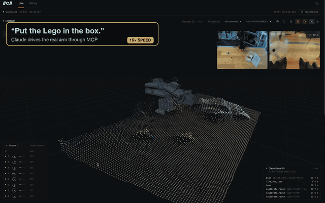
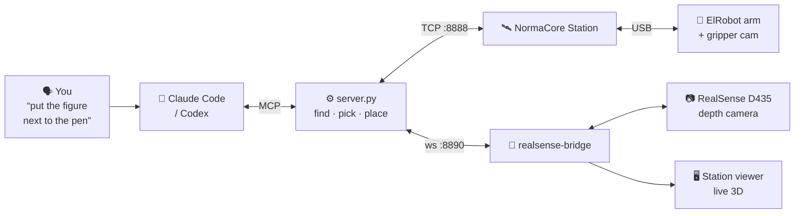
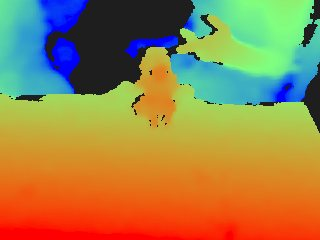
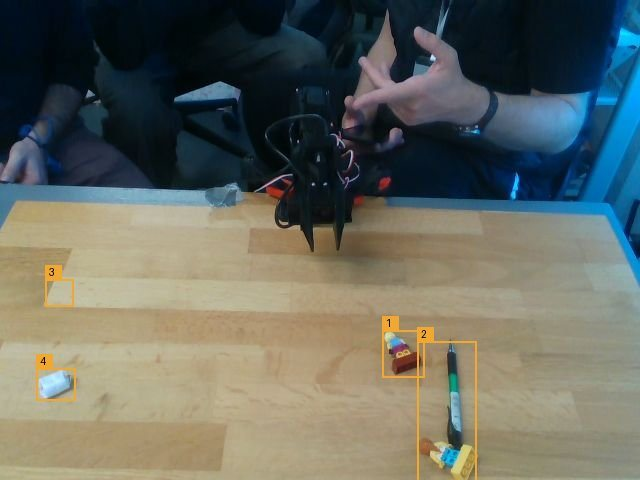
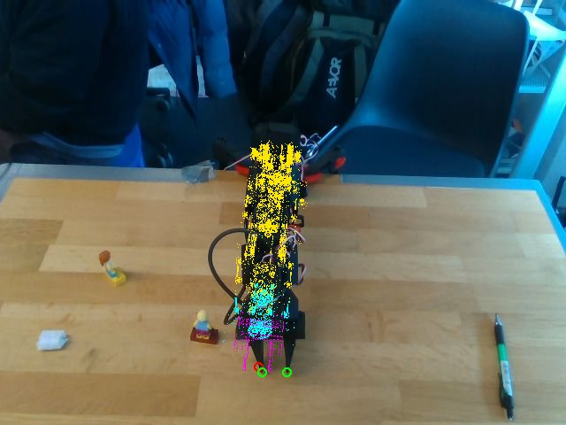
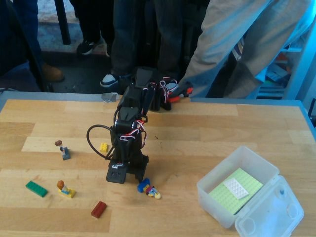
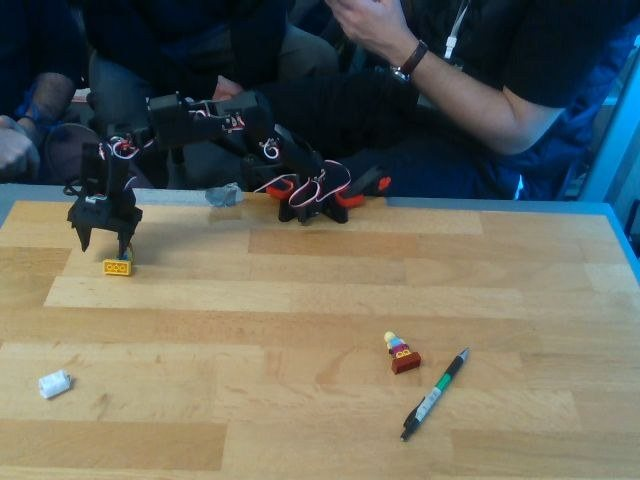
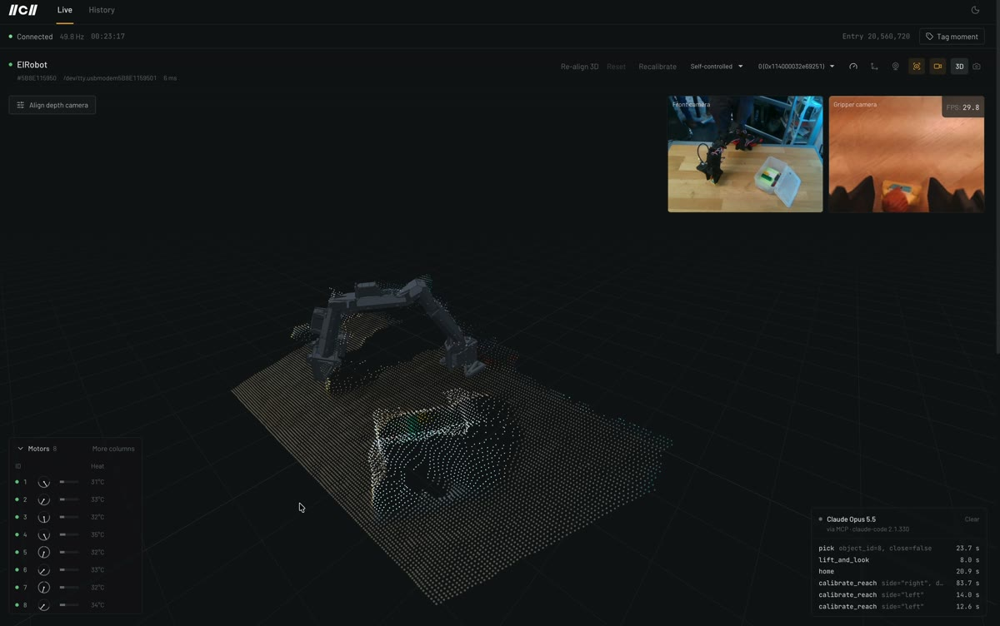
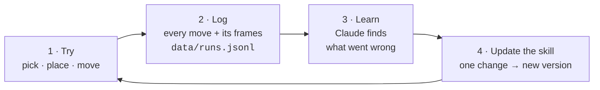
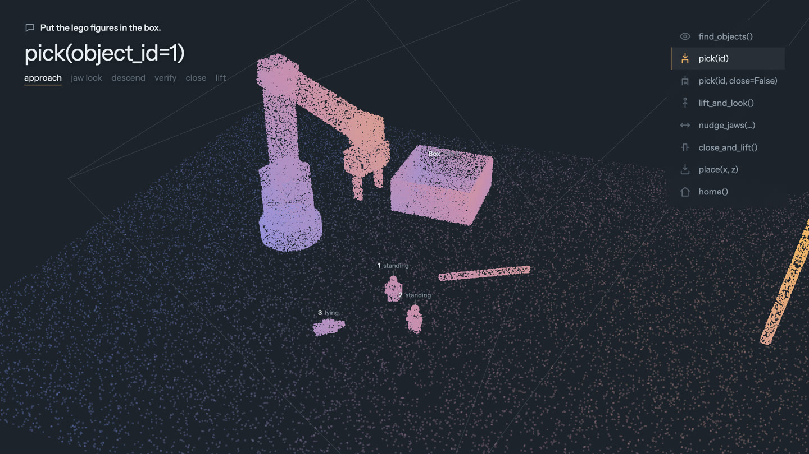

<div align="center">

# 🦾 NormaCore × AI

**Tell a robot arm what to move where. It looks, finds the thing, picks it up and checks its own work.**



<sub>A real run, 16× speed: the station viewer with the robot model, the depth point cloud, both cameras and Claude’s tool calls. <a href="docs/media/hero.mp4">Sharper MP4</a></sub>

<sub>Built at the NormaCore hackathon, November 2026 · challenge: <i>“AI-powered robot control: integrate the Station API into Codex or Claude so it can control the robot by looking through the cameras.”</i></sub>

</div>

---

## The idea in one line

> *“Put the Lego figure in the box.”* That is the whole interface.

Claude Code (or Codex) talks to an **MCP server** we wrote. The server turns that sentence into camera looks and
arm moves on a real **ElRobot** arm, run through **NormaCore Station**.

**Geometry stays out of the LLM.** The code measures things (depth, table plane, inverse kinematics, where the
jaw tips are). Claude decides what to do next, reads the photos and notices when something looks wrong.

## How it works



<table>
<tr>
<td width="33%"><br><b>1 · See</b><br>A depth camera on the far side of the table streams through our bridge.</td>
<td width="33%"><br><b>2 · Find</b><br><code>find_objects</code> numbers every object and gives its position in metres from the robot base.</td>
<td width="33%"><br><b>3 · Know the arm</b><br>A URDF model fitted to the depth points calibrates the camera pose and the joint zeros.</td>
</tr>
<tr>
<td><br><b>4 · Pick</b><br>Down from above with the jaws open. Look at the photo, <code>nudge_jaws</code>, then <code>close_and_lift</code>.</td>
<td><br><b>5 · Check & retry</b><br>Missed? <code>lift_and_look</code> and try again from where it is. No going home in between.</td>
<td><br><b>6 · Watch it live</b><br>Our station-viewer fork shows the robot, the point cloud and the cameras in one 3D view.</td>
</tr>
</table>

## What we built

| | |
|---|---|
| ⚙️ **MCP server** (`server.py`) | 31 tools. The everyday ones are `find_objects` → `pick` → `place` / `place_near` → `home` |
| 📷 **Depth vision** (`depth.py`) | Color + depth object detection, a table-plane model, median of 5 frames against noise |
| 🦴 **Arm model** (`arm_model.py`, `arm_fit.py`) | URDF forward and inverse kinematics, plus a fit of the camera pose and joint zeros to depth points |
| 🏃 **Motion engine** (`motion.py`) | Smooth moves with stall detection ("servo 6 is 0.12 from its target: blocked") |
| 🛑 **Safety** (`estop.py`) | A separate e-stop program (Space = hold, X = relax), a guard against leader→follower mirroring, `hold` / `relax` |
| 📡 **RealSense bridge** (`realsense-bridge/`) | Streams D435 depth and color over websocket and stores the calibration |
| 🖥️ **Station viewer** (`station-viewer-patches/`) | Dark restyle, live 3D point cloud, IK/arm-pose preview, agent panel |
| 🔁 **Self-improvement** (`learn.py`, `CLAUDE.md`) | Logs every attempt, versions the skills, practice ladder for speed, lessons kept in *Learned facts* |

## 🔁 It gets better every run

The MCP doesn't just execute: it **keeps improving the robot's movements, one iteration at a time.**



- **Every try is logged** with the camera frames it used, so misses are debugged from data, not memory.
- **Claude changes one thing per iteration** and saves it as a new version of the skill: a corrected pose, a
  re-measured offset (jaw offset, reach map) or a new rule built into the tool. The old version is kept so it can roll back.
- **Practice ladder:** 2 clean runs in a row → the skill speeds up a step (0.5× → 0.75× → 1.0× → … → 2.0×).
  A miss → one step slower, then fix.
- **Lessons stay:** what it learns goes into *Learned facts* in [`CLAUDE.md`](CLAUDE.md), so the next session
  starts from the last one's lessons. Some rules it learned on the real arm:

| Mistake on the real arm | Rule now built into the tool |
|---|---|
| A sideways nudge pushed a figure 8 cm | Go up over the top, across, then down |
| Going home after a miss cost 30 s | Lift, look, retry from where it is |
| A low swing knocked a Lego over | Rise to 15 cm after placing |
| The jaws landed 2.5–3 cm short | Aim further out (`calibrate_reach`) |

<p align="center"></p>

## How far we got

- ✅ **Pick and place works on the real arm** for standing objects within about 36 cm. In the final session 3 of 4 figures were picked and put next to the pen.
- ✅ Camera pose, reach and jaw offset are calibrated. Moves are smooth, stalls are caught and reported, and the e-stop works.
- 🟡 Skill versions and the practice ladder are built and tested offline. On the real arm so far, the improvement came from logged lessons and re-measured offsets.
- 🟡 Flat or far objects need the look-and-adjust steps (open jaws, look, nudge, close).
- 🔜 Next: the depth camera mounted at ≥50° looking down, the gripper camera used in the check before closing, and `pick` retrying by itself.

## Try it

```sh
git clone --depth 1 https://github.com/norma-core/norma-core.git ~/norma-core
uv venv --python 3.12 .venv && uv pip install --python .venv/bin/python -r requirements.txt
claude mcp add normacore -e NORMA_CORE_REPO=$HOME/norma-core -e STATION_HOST=localhost \
  -e FOLLOWER_BUS=<FOLLOWER_SERIAL> -- $PWD/.venv/bin/python $PWD/server.py
```

Then tell Claude: *“find the objects on the table and put the figure next to the pen.”*

👉 Full setup (hardware, Station, env vars, e-stop, first run): **[docs/SETUP.md](docs/SETUP.md)**
👉 How the agent drives the arm (workflow, rules, calibration, learned facts): **[CLAUDE.md](CLAUDE.md)**
👉 No robot? `python tests/offline_test.py . ~/norma-core` runs the whole server against a fake Station.

## Repo map

```
server.py              MCP server: the tools Claude calls
depth.py               depth + color vision, object finding
arm_model.py arm_fit.py  kinematics and camera/arm calibration
motion.py estop.py     motion engine and safety
learn.py activity.py   attempt logging and skills
realsense-bridge/      D435 → websocket bridge + calibration.json
station-viewer-patches/ our norma-core station-viewer changes
notes/                 pitch, station notes, 3D explainer, design directions
data/                  calibrations, reach map, fit samples, run log
tests/                 offline tests (no hardware needed)
```

<div align="center"><sub>Made with a lot of Lego figures, one green pen and Claude Code.</sub></div>
